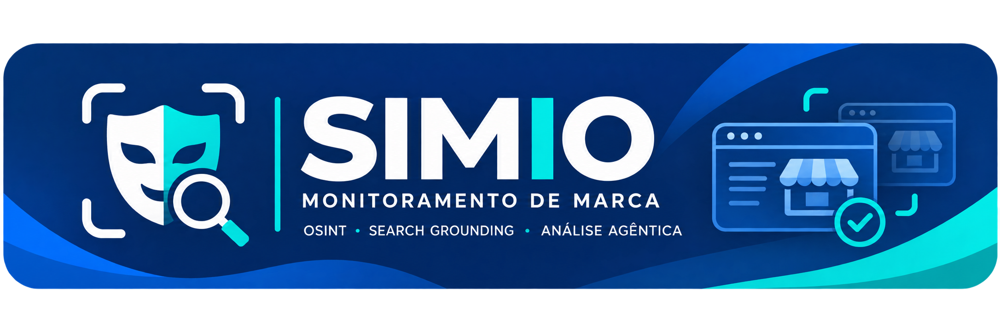

<p align="center">
  
</p>

# SIMIO

O SIMIO procura na internet páginas e perfis que usam a marca Banco BV, coleta cada página num navegador isolado, analisa o que encontrou com regras e com o Gemini (Vertex AI) e gera planilha, relatório e dossiês para revisão.

A pergunta que ele tenta responder é esta: a forma como a página se apresenta pode levar o consumidor a achar que está falando com o banco, quando na verdade é um correspondente bancário ou outro terceiro? Além disso, ele procura páginas que se passam pelo banco para enganar clientes (login falso, boleto, app fora das lojas) e o uso da logo antiga, que terceiros não podem mais usar.

Para chegar a uma resposta, cada página é olhada por cinco ângulos:

1. Como a página se identifica: título, cabeçalho, domínio, rodapé, razão social e CNPJ.
2. Identidade visual: logotipo e cores acima da dobra, a partir das capturas de tela.
3. Quem opera a página de fato, separando o CNPJ do banco citado no texto do CNPJ de quem mantém o site.
4. Se há a declaração de correspondente exigida pela Resolução CMN nº 4.935/2021 (art. 14, III), onde ela aparece e se nomeia o banco.
5. A jornada de atendimento: "canal oficial", "central 0800", 2ª via de boleto, quitação com desconto e captação por WhatsApp.

Lojas que trabalham com vários bancos, notícias, reclamações e homônimos da sigla "BV" são tratados à parte para não virarem alerta. Os detalhes estão em [docs/methodology.md](docs/methodology.md).

## Como funciona

Uma campanha passa por sete etapas, sempre na mesma ordem:

1. Descoberta: dorks no Google (via Serper e via Grounding do Gemini), domínios parecidos com os oficiais, certificados (crt.sh) e busca reversa da logo antiga.
2. Coleta: Chromium com sandbox, atrás de um proxy local que bloqueia acesso à rede interna. Gera capturas, código-fonte, texto e um manifesto com SHA-256.
3. Identidade: CNPJs, razão social e cruzamento com o cadastro de correspondentes (COBAN).
4. Marca: o Gemini olha as capturas e o texto; uma heurística local faz a mesma análise em paralelo e as duas são comparadas.
5. Revisão: um segundo modelo, cético, pode rebaixar o caso, pedir nova coleta ou marcar como inconclusivo.
6. Decisão: regras fixas validam as referências às evidências e aplicam os pisos (logo antiga, pedido de senha ou cartão).
7. Relatórios: planilha Excel, relatório HTML e PDF, relatório de ameaças e dossiês por página.

Tudo fica num SQLite local. Se a campanha parar no meio (erro, Ctrl+C, limite de uso do LLM), `retomar` continua de onde parou sem pagar de novo pelas análises já feitas.

Mais detalhes:

- [docs/architecture.md](docs/architecture.md): módulos, máquina de estados, descoberta e controle de orçamento.
- [docs/methodology.md](docs/methodology.md): hipóteses de busca, filtros, pesos, triagem de ameaças e regras de decisão.
- [docs/deployment.md](docs/deployment.md): instalação, Vertex AI, proxy corporativo, Serper, cadastro de COBANs, custos e migração.
- [docs/security.md](docs/security.md): isolamento de rede e do navegador, prompt injection, LGPD e segredos.

## Instalação

Precisa de Python 3.11 ou mais novo, um projeto no Google Cloud com a Vertex AI habilitada e acesso à internet (direto ou por proxy).

Linux ou macOS:

```bash
python -m venv .venv && source .venv/bin/activate
pip install -e ".[dev]"
python -m playwright install chromium
cp .env.example .env
```

Windows (PowerShell), a partir da pasta do projeto:

```powershell
python.exe -m venv .venv
.venv\Scripts\Activate.ps1
pip.exe install --upgrade pip
pip.exe install -e ".[dev]"
python.exe -m playwright install chromium
copy .env.example .env
```

Autentique no Google Cloud e confira o ambiente:

```bash
gcloud auth application-default login
python -m simio diagnostico          # --real faz uma chamada mínima à Vertex AI e ao Grounding
```

Depois do `pip install -e .`, o comando `simio` também fica disponível (`simio investigar ...` é o mesmo que `python -m simio investigar ...`).

## Configuração

O `.env` mínimo:

```ini
SIMIO_PROJETO_GCP=<id-do-projeto>
SIMIO_LOCAL_GCP=global
SIMIO_MODELO_ANALISE=gemini-3.8-flash
# revisão e descoberta usam o modelo da análise se ficarem vazios
SIMIO_MODELO_REVISAO=
SIMIO_MODELO_DESCOBERTA=
```

Para a varredura mensal completa, acrescente a chave do Serper e aumente os limites:

```ini
SIMIO_CHAVE_API_SERPER=<chave>
SIMIO_MAX_CONSULTAS_BUSCA=300
SIMIO_MAX_REQUISICOES_LLM=2500
SIMIO_MAX_TOKENS_LLM=25000000
SIMIO_CAMINHO_CADASTRO_COBAN=data/coban_registry_bv.csv
SIMIO_CADASTRO_COBAN_OFICIAL=true
SIMIO_LIMITE_SEMENTES_COBAN=40
```

Todas as variáveis estão comentadas em [.env.example](.env.example). Custos e dimensionamento em [docs/deployment.md](docs/deployment.md).

## Uso

Investigação ampla (o padrão), analisando até 50 páginas:

```bash
python -m simio investigar --marca bv --limite 50
```

Varredura mensal:

```bash
python -m simio investigar --marca bv --limite 1000 --paralelismo 5
```

`--limite` conta páginas analisadas, não buscas. A descoberta roda inteira e o limite só corta a fila, que já vem ordenada por risco.

Campanhas focadas:

```bash
python -m simio investigar --foco logo-antiga --limite 1000 --paralelismo 5
python -m simio investigar --foco ameacas --limite 500 --paralelismo 5
```

Na campanha de logo antiga, só vão aos modelos as páginas em que a logo foi confirmada por comparação de imagem ou que têm imagem com o nome da marca no arquivo ou no `alt`; as outras fecham como "Sem indício" sem custo de IA. A campanha de ameaças não usa o cadastro de COBANs e procura login falso, coleta de senha ou cartão, apps e sites em hospedagem gratuita.

Para escolher as fontes, use `--fontes serper,grounding` (valores possíveis: `grounding`, `serper`, `brave`, `urlscan`, `crtsh`, `typosquat`, `lens`).

Analisar uma lista de URLs:

```bash
python -m simio investigar --arquivo-urls urls_suspeitas.txt --limite 30
python -m simio investigar --urls "https://exemplo.com.br https://outro.com"
python -m simio investigar --offline --arquivo-urls urls_suspeitas.txt   # sem Vertex AI nem APIs de busca, só heurística
```

Outras opções do `investigar`: `--max-consultas`, `--max-requisicoes-llm`, `--max-tokens`, `--modelo`, `--modelo-revisao`, `--revisar-todas` (manda todas as páginas ao revisor), `--sem-relatorio` e `-o/--dir-saida`.

Retomar, gerar relatórios, consultar:

```bash
python -m simio retomar                                   # campanha mais recente
python -m simio retomar -c 2026-11-25_19h05_bv_ameacas --repetir-falhas
python -m simio relatorio -c <ID>                         # --todos-dossies gera dossiê de todas as páginas
python -m simio enriquecer -c <ID>                        # RDAP e DNS dos hosts que ainda não têm; --atualizar refaz todos
python -m simio status                                    # campanha mais recente
python -m simio status --listar                           # últimas 50 campanhas
python -m simio testar                                    # pytest; --real inclui os testes com Vertex/Grounding
```

O `retomar` usa os parâmetros originais da campanha, inclusive o `--foco`. O `investigar` e o `retomar` já levantam registro, DNS e hospedagem dos achados antes do relatório; o `enriquecer` serve para campanhas antigas ou para completar hosts que falharam.

Preparar o cadastro de correspondentes (todo mês, a partir da exportação do operador):

```bash
python scripts/preparar_cadastro_coban.py Todos_Cobans_Ativos.xlsx --saida data/coban_registry_bv.csv --data-referencia 2026-10-06
```

## Onde ficam os resultados

Tudo fica em `resultados/` (mude com `SIMIO_DIR_SAIDA` ou `-o`):

```
resultados/
  simio.db                          banco SQLite (campanhas, evidências, decisões, uso do LLM)
  registros/simio.jsonl             log de execução, com segredos mascarados
  pontuacao.toml                    opcional: sobrepõe os pesos da heurística (ver docs/methodology.md)
  campanhas/
    2026-11-25_19h05_bv_ameacas/    data e hora de Brasília, marca e modo (ampla, logo-antiga, ameacas)
      relatorio.xlsx
      relatorio.html
      relatorio.pdf
      ameacas.html                  só quando há ameaças
      dominios.json                 registro, DNS e hospedagem dos achados
      dossies/<host>_<id>.html
      logo-antiga/<host>_<id>.png   recorte da captura onde a logo antiga apareceu
      evidencias/<host>_<id>/tentativa-1/
        tela-inicial.png
        pagina-inteira.png
        codigo-fonte.html.txt
        texto-visivel.txt
        dados-da-pagina.json
        manifesto.json              SHA-256 de cada arquivo da coleta
      anteriores/<data>/            relatórios da geração anterior, movidos quando o relatório é gerado de novo
```

Se já existir uma campanha com o mesmo minuto, o id ganha `-2`, `-3` e assim por diante.

A planilha tem as abas Resumo, Candidatos, Indícios fortes, Responsáveis, Evidências, Registro da investigação, Erros e limitações e Glossário. Quando há o que mostrar, entram também Logo antiga (com o recorte da imagem), Ameaças, Domínios e Entidades. Na campanha de ameaças, as abas Ameaças e Domínios vêm logo depois do Resumo. Caminhos de capturas e dossiês são links clicáveis.

## Classificações

Cada página termina com uma classificação final:

| Classificação | Quando |
|---|---|
| Indício forte | Pelo menos dois indicadores de confusão com evidência válida e coleta utilizável |
| Requer revisão | Há sinais, mas falta algo para indício forte, ou modelo e regras discordaram |
| Inconclusiva | Evidência insuficiente (coleta falhou, página vazia, bloqueio) |
| Sem indício | Menção legítima, sem relação com o banco ou descartada pela revisão |

E um cenário: A · Menção comercial legítima, B · Comunicação ambígua, C · Possível canal oficial, D · Personificação forte, E · Evidência insuficiente, ou Não relevante. A prioridade é Alta, Média ou Baixa. Na triagem de ameaças, o nível é Crítico, Alto, Médio, Baixo ou Sem ameaça.

O banco guarda os códigos (`INDICIO_FORTE`, `REQUER_REVISAO`, `D_PERSONIFICACAO_FORTE`...); planilha, HTML e PDF mostram os rótulos acima.

## Migrar resultados antigos

Versões anteriores gravavam em `output/` (banco com tabelas em inglês, ids como `simio-20261118-184932-cc75`, evidências em `evidence/<id>/attempt-N/`). Para trazer isso para `resultados/`:

```bash
cp output/simio.db output/simio.db.bak               # cópia de segurança
python -m simio status -o output                     # atualiza o banco para o esquema atual (v3)
python scripts/migrar_resultados.py --simular        # mostra o plano sem mexer em nada
python scripts/migrar_resultados.py                  # move de fato
```

O script renomeia as campanhas para o id novo, move evidências e `domain-intel.json` (que vira `dominios.json`), põe os relatórios antigos em `anteriores/legado/`, confere os SHA-256 dos manifestos e termina sugerindo os comandos `simio relatorio` para gerar os relatórios no layout novo. Não rode com uma campanha em execução. Os nomes das variáveis do `.env` também mudaram; veja a tabela em [docs/deployment.md](docs/deployment.md#migrar-do-layout-antigo).

## Adaptar para outra marca ou caso

- Perfil de marca: um `.toml` em `src/simio/marcas/` (domínios e perfis oficiais, CNPJs, termos, homônimos, sementes de typosquatting, referências da logo antiga). Use com `--marca <id>`.
- Hipóteses e dorks: `montar_hipoteses()` em `src/simio/agentes/descoberta.py`. Uma hipótese nova roda em todas as fontes.
- Modo de campanha novo: nome em `MODOS_FOCO`, hipóteses e fontes padrão (`FONTES_PADRAO_FOCO`) em `src/simio/agentes/descoberta.py` e, se precisar de triagem própria, em `_analisar()` de `src/simio/nucleo/orquestrador.py`.
- Conector de busca: `src/simio/provedores/busca.py`.
- Requisitos normativos: `src/simio/conhecimento/cmn_4935.toml`. Requisitos contratuais entram por um TOML próprio em `SIMIO_CAMINHO_REQUISITOS_CONTRATUAIS`.
